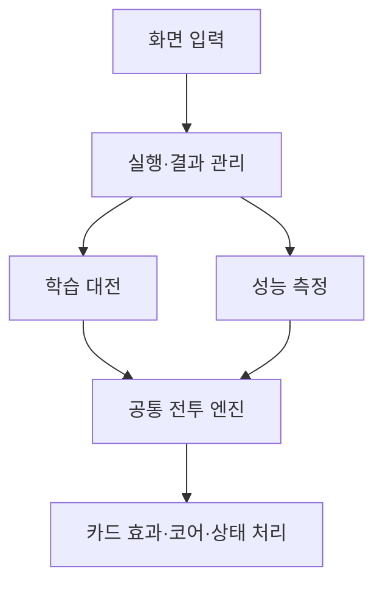

# 신디게이트 서울 카드 밸런스 시뮬레이터

**카드의 조건별 효과와 덱에 넣었을 때의 기여도를 반복 실험으로 비교하는 밸런스 검토 도구입니다.**

게임 카드 데이터를 바탕으로 자동 대전과 성능 측정을 수행합니다. 단순 피해량만으로 비교하기 어려운 조건부 효과, 특정 카드팩과의 연계, 덱 편입에 따른 성적 차이를 살펴보고 추가 검토할 카드를 찾는 데 사용할 수 있습니다.

**[웹에서 시뮬레이터 실행하기](https://holickw.github.io/card-simulator/)**

현재 일반 카드 245종과 7개 카드팩을 대상으로 분석할 수 있습니다. 브라우저에서 계산하며, 웹 실행에는 별도 설치가 필요하지 않습니다.

## 어떤 내용을 확인할 수 있나요?

- 같은 카드라도 기본 상태와 효과 발동 조건을 준비한 상태에서 결과가 얼마나 달라지는지
- 같은 덱의 한 자리를 해당 카드로 채웠을 때, 효과 없는 카드로 채운 경우보다 얼마나 도움이 되는지
- 기본 공용 카드 중심의 덱과 해당 카드팩을 활용한 덱에서 기여도가 어떻게 달라지는지
- 같은 티어의 카드 중 상대적으로 기여도가 높거나 낮은 카드가 무엇인지
- 학습 대전에서 어떤 카드와 카드팩 조합이 함께 편입된 덱에서 높은 승률을 보였는지

여기서 **카드 티어(T1~T5)**는 게임 데이터에 정해진 분류이며, **분석 등급(S~F)**은 시뮬레이터의 분석 결과입니다. 서로 다른 기준입니다.

## 두 가지 실행 방식

| 구분 | 학습 대전 | 성능 측정 |
| --- | --- | --- |
| 목적 | 다양한 덱의 대전 결과와 카드 선택 경향 탐색 | 고정된 기준에서 카드 한 장의 효과와 기여도 비교 |
| 진행 방식 | 선택한 팩으로 덱을 구성하고 반복 대전 | 조건별 효과 측정과 덱 한 자리 교체 실험 |
| 대전 중 선택 | 승패에 따라 카드별 선택 가중치를 갱신 | 학습 결과를 사용하지 않고 선택 가중치를 고정 |
| 주요 결과 | 사용 통계, 덱 승률, 카드·팩 조합 통계, 잠정 등급 | 효과량, 빈 슬롯 대비 승점 변화, 오차 범위, 실측 등급 |

두 방식은 같은 전투 엔진을 사용합니다. 학습 대전의 AI는 정해진 판단 규칙과 카드별 선택 가중치로 행동합니다. 학습에 따라 달라지는 값은 **카드 선택 가중치**이며, 카드의 피해량이나 비용을 자동으로 수정하지는 않습니다.

## 처음 사용하는 경우

카드 간 성능을 비교하려면 **성능 측정**부터 실행하면 됩니다. 학습 대전을 먼저 진행할 필요는 없습니다.

1. 웹 시뮬레이터를 열고 분석할 **카드팩과 티어 제한**을 선택합니다.
2. **덱 크기 20장**, **측정 대상 전체 카드**, **카드·덱별 시드 수 200**, **시작 시드 1**로 설정합니다.
3. **성능 측정 시작**을 누릅니다. 일반 덱 측정이 기본이며, 팩 활용에 따른 차이를 보려면 **팩 전용 덱도 측정**을 선택합니다.
4. **성능 측정** 탭에서 카드별 기여도를 비교하고, **밸류 티어**와 **밸런스 경고**에서 검토할 카드를 확인합니다. 카드를 선택하면 상세 결과를 볼 수 있습니다.
5. 다양한 덱의 편입·사용 경향도 살펴보려면 **학습 대전 시작**을 실행한 뒤 시너지 분석, 팩 교차, 전투 로그를 확인합니다.

전체 245종을 200시드로 측정하면 일반 덱의 교체 실험만 **196,000전**을 실행합니다. 조건별 효과 측정은 별도로 진행되며, 소요 시간은 실행 환경에 따라 달라집니다. 먼저 화면과 결과 형식을 확인하려면 **대표 카드 16장**을 선택해 실행한 뒤 전체 측정으로 넘어갈 수 있습니다.

시드는 카드 섞기와 확률 효과 등에 사용하는 **난수 조건을 재현하기 위한 값**입니다. 같은 카드 데이터·실행 규칙·측정 설정과 시작 시드를 사용하면 성능 측정 결과를 재현할 수 있습니다. 시작 시드 입력은 성능 측정에 적용됩니다.

### 입력할 수 있는 값

| 입력값 | 적용 대상 | 의미·기본값 |
| --- | --- | --- |
| 카드팩 | 공통 | 학습에서는 덱 구성에 사용할 팩, 성능 측정에서는 평가할 카드의 소속 팩 선택. 기본 공용 팩은 항상 포함 |
| 티어 제한 | 공통 | 허용할 최대 티어. 예를 들어 T3을 선택하면 T1~T3 대상 |
| 덱 크기 | 공통 | 목표 덱 크기. 기본 20장, 10~40장 설정. 학습 대전에서는 카드 채택 결과에 따라 목표보다 적을 수 있음 |
| 세대당 게임 수 | 학습 대전 | 각 티어 매치의 반복 대전 수. 기본 100판 |
| 학습 세대 수 | 학습 대전 | 대전과 통계 집계를 반복할 횟수. 기본 10세대 |
| 측정 대상 | 성능 측정 | 선택 범위 전체 카드 또는 빠른 확인용 대표 16장 |
| 카드·덱별 시드 수 | 성능 측정 | 카드 한 장을 각 덱 환경에서 측정할 난수 조건 수. 기본 200개 |
| 시작 시드 | 성능 측정 | 난수 조건의 시작값. 기본 1 |
| 팩 전용 덱도 측정 | 성능 측정 | 일반 덱에 더해 해당 카드팩을 활용하는 덱에서도 측정할지 선택 |

학습 대전을 T5까지 기본 설정으로 실행하면 `100판 × 10세대 × 5개 티어 매치 = 5,000판`을 수행합니다. 성능 측정의 실험 덱, 상대 덱, 체력·에너지 조건은 별도로 정해진 기준을 사용합니다.

## 결과 화면과 활용 방법

| 화면 | 확인할 수 있는 내용 | 활용 예시 |
| --- | --- | --- |
| 성능 측정 | 기본·조건별 효과, 일반·팩 전용 덱의 기여도, 측정 표본과 오차 범위 | 조건을 준비해야 강해지는 카드와 범용적으로 유용한 카드 구분 |
| 밸류 티어 | 같은 티어 내 실측 등급·순위 또는 학습 기준 잠정 등급 | 같은 티어의 카드 간 상대적인 성능 차이 검토 |
| 밸런스 경고 | 실측 기준으로 기여도가 높거나 빈 슬롯보다 불리한 카드 | 추가 플레이테스트와 수치 검토 대상 선정 |
| 시너지 분석 | 카드 두 장이 함께 들어간 덱의 승률 | 연계 효과를 더 확인할 카드 조합 탐색 |
| 팩 교차 | 덱에 포함된 카드팩 조합별 승률과 표본 수 | 특정 팩 조합의 성적 편중 확인 |
| 팩별 통계 | 팩별 카드 편입 통계와 사용 횟수 | 팩별 사용 경향 확인 |
| 티어 히트맵 | 카드 티어별 분석 등급 분포 | 특정 티어에 낮은 등급이 몰려 있는지 확인 |
| 학습 그래프 | 세대별 A측 승률 추이 | 학습 대전 진행 양상 확인 |
| 전투 로그 | 표본 전투의 덱 구성, 승패, 체력, 턴별 카드 사용 | 수치 차이가 발생한 전투 과정 추적 |
| 카드 풀 | 분석에 사용하는 카드 목록과 효과 설명 | 카드의 원래 사양과 분석 결과를 함께 확인 |

시너지 분석과 팩 교차는 **해당 조합이 포함된 덱의 관측 승률**입니다. 다른 카드나 상대 덱의 영향도 포함하므로, 조합 자체가 승률을 높였다는 증거로 단정하지 않습니다. 학습 그래프의 A측 승률 역시 AI 전체의 성능 향상을 뜻하지 않습니다.

## 성능은 어떻게 측정하나요?

### 1. 조건별 카드 효과

**기본**, **중간 준비**, **조건 준비 예시**의 정해진 상태에서 카드를 사용해 피해, 실드, 회복, 드로우, 에너지 변화 등을 측정합니다. 일부 코어와 재구축 효과는 정해진 후속 행동을 실행한 뒤 3턴·5턴 시점의 차이도 기록합니다.

이 값은 해당 조건에서의 효과입니다. 실제 전투에서 그 조건을 얼마나 자주 만들 수 있는지를 측정한 값은 아닙니다. 화면의 공격·방어 단위는 피해 6과 실드 6을 각각 1로 표시하며, 승점 변화와는 별개의 지표입니다.

### 2. 덱 한 자리 교체 실험

예를 들어 20장 덱을 평가할 때, 나머지 19장은 같게 유지하고 한 자리만 바꿉니다.

- **후보 덱:** 평가할 카드 1장 + 나머지 19장
- **대조 덱:** 효과 없는 카드 1장 + 같은 나머지 19장

대조 덱의 효과 없는 카드를 화면에서는 **빈 슬롯**이라고 부릅니다. 덱 크기는 양쪽이 같습니다.

같은 시드에서 각 덱을 선공·후공으로 실행하므로 **시드 하나당 4전**, 200시드는 **카드 한 장·덱 환경 하나당 800전**입니다. 승리 1점, 무승부 0.5점, 패배 0점으로 계산한 평균 승점 차이를 `%p`로 표시합니다.

예를 들어 `+5%p`라면, 이 실험 조건에서 후보 카드를 넣은 덱의 평균 승점이 빈 슬롯을 넣은 덱보다 0.05 높았다는 뜻입니다. 이는 설명을 위한 예시이며 실제 측정 결과가 아닙니다.

- **일반 덱:** 기본 공용 카드 중심의 보조 덱에 후보 카드 한 장을 넣습니다.
- **팩 전용 덱:** 기본 공용 카드와 후보 카드의 소속 팩 카드를 함께 사용하는 보조 덱에 후보 카드를 넣습니다. 기본 공용 카드의 경우 일반 덱과 같은 구성입니다.

보조 카드와 상대 덱은 후보 카드의 티어 이하·비용 3 이하 카드에서 정해진 규칙으로 구성합니다. 결과에는 화면의 **95% 구간**으로 측정의 불확실성도 함께 표시합니다. 구간이 0을 걸치면 유리한지 불리한지 해석할 때 주의가 필요합니다.

### 3. 등급과 경고

- 카드당 **200시드 이상** 측정하고, 같은 티어에서 이 기준을 만족한 카드가 **10장 이상**이면 일반 덱의 기여도 순위로 실측 등급을 표시합니다.
- 등급 구간은 상위 10% S, 다음 20% A, 다음 40% B, 다음 20% C, 나머지 D입니다. 빈 슬롯 대비 승점 변화의 95% 구간 상한도 0보다 작으면 F로 표시합니다. 동점과 F 판정에 따라 실제 등급별 카드 수 비율은 달라질 수 있습니다.
- **OP 경고**는 같은 티어의 측정 대상 중 상위 5%이면서 95% 구간 하한이 0보다 큰 카드, **UP 경고**는 빈 슬롯보다 불리한 F 카드에 표시합니다.
- 실측 등급을 만들 수 없으면 사용 기록이 있는 카드에 학습 가중치 기반 **잠정 등급**을 표시합니다. 실측 등급도 사용 기록도 없으면 `?`로 표시합니다.

실측은 **이 시뮬레이터의 반복 실험에서 얻은 측정값**을 뜻합니다. 실제 이용자 플레이테스트 결과나 최종 밸런스 판정은 아닙니다. 등급은 같은 티어에서 충분히 측정된 카드 사이의 상대 순위이므로, T1의 S등급과 T5의 S등급이 같은 전투력을 뜻하지 않습니다. 대표 카드 16장은 빠른 기능 확인용이며 실측 등급을 만들기 위한 전체 평가를 대신하지 않습니다.

## 저장과 현재 지원 범위

- **학습 데이터 내보내기 / 불러오기:** 카드 선택 가중치, 누적 통계, 학습 이력, 성능 측정 보고서를 JSON으로 저장하고 불러옵니다. CLI에서 생성한 성능 보고서만 불러오는 것도 지원합니다.
- **저장 범위:** 상세 전투 로그, 시너지·팩 조합 집계, 화면 설정은 저장 파일에 포함되지 않습니다. 자동 저장은 지원하지 않습니다.
- **데이터 편집:** 화면에는 카드 비용·효과나 개별 덱을 직접 편집하는 기능이 없습니다. 카드 데이터는 원본 Unity 프로젝트의 JSON에서 동기화한 사본을 사용합니다.
- **실험 이력:** 새 성능 측정은 현재 보고서를 교체합니다. 결과 파일을 개별 보관할 수 있지만, 여러 실험을 나란히 비교하거나 중단 지점부터 이어서 측정하는 기능은 없습니다.
- **해석 범위:** 전투 규칙은 JavaScript로 구현했으며, Unity 엔진을 직접 실행하지 않습니다. 고정된 덱 구성과 자동 행동 규칙 아래에서 검토 대상을 찾는 도구로 활용하고, 실제 게임에서의 체감과 조건 달성 난이도는 별도 플레이테스트로 확인해야 합니다.

## 검증 기록

2026-10-16에 확인한 구현 검증 기록입니다.

- **자동 테스트 75개 통과:** 카드 데이터, 전투·효과 처리, 학습, 성능 측정과 저장 데이터 검증 등을 확인했습니다.
- **덱 구성 수정 전후 비교:** 학습 전 AI에서 티어 제한별로 1,000개씩, 총 5,000개 덱을 같은 설정·시드 조건으로 생성했습니다. 희귀도별 최대 장수를 초과한 덱은 수정 전 **536개**, 수정 후 **0개**였습니다.

위 수치는 덱 구성 로직 수정에 대한 검증입니다. 실제 게임의 밸런스나 이용자 경험이 개선됐다는 수치를 뜻하지는 않습니다.

## 코드 구성



| 파일 | 역할 |
| --- | --- |
| `index.html`, `index.css`, `js/app.js` | 실행 설정, 결과 탭, 카드 상세, 그래프와 로그 표시 |
| `js/cards.js`, `js/newworld-cards.js` | 카드 목록과 동기화한 원본 데이터 |
| `js/simulator.js` | 반복 대전 실행, 진행 상태, 통계와 등급 집계 |
| `js/engine.js`, `js/battle-rules.js` | 전투 상태, 턴 진행, 카드 사용과 공통 규칙 |
| `js/effects.js`, `js/effects-bio-gamble.js`, `js/core-effects.js` | 효과별 처리와 지속 코어 동작 |
| `js/ai.js` | 덱 구성, 행동 선택, 카드 선택 가중치 갱신 |
| `js/performance.js`, `js/performance-view.js` | 조건별 효과·교체 실험·등급 계산과 결과 표 |
| `js/performance-worker.js`, `scripts/worker-pool.mjs` | 브라우저와 Node에서 카드별 성능 측정 병렬 실행 |
| `scripts/sync-newworld.mjs` | Unity 카드 JSON 동기화와 데이터 버전 생성 |
| `tests/` | 카드 데이터, 전투·효과, 학습, 성능 측정과 동기화 검증 |

<details>
<summary>로컬 실행 및 개발 명령</summary>

### 웹 화면 실행

저장소 루트를 정적 HTTP 서버로 실행합니다. Python 3을 사용하는 경우:

```sh
python -m http.server 8000 --bind 127.0.0.1
```

브라우저에서 [로컬 시뮬레이터](http://127.0.0.1:8000/)를 엽니다. 별도의 프런트엔드 빌드 단계는 없습니다.

### 테스트와 CLI 성능 측정

Node.js 16 이상에서 실행합니다.

```sh
# 자동 테스트
npm test

# 전체 카드의 일반 덱 성능 측정
npm run evaluate -- --all --seeds 200 --output performance-all.json

# 팩 전용 덱까지 함께 측정
npm run evaluate -- --all --seeds 200 --dedicated --output performance-all-dedicated.json
```

생성한 성능 보고서는 웹 화면의 **학습 데이터 불러오기**에서 열 수 있습니다. 자동 테스트는 데이터 일치, 카드·턴·효과 처리, 학습 통계, 측정 재현성, 병렬 결과 일치와 JSON 검증 등을 다룹니다. 실제 브라우저 화면 조작과 Unity 런타임과의 동등성은 이 자동 테스트의 검증 범위에 포함되지 않습니다.

### 원본 카드 데이터 동기화

```sh
npm run sync:newworld -- --source "D:/NewWorld"
npm run check:newworld -- --source "D:/NewWorld"
```

`D:/NewWorld`는 원본 Unity 프로젝트의 예시 경로이며 실제 위치에 맞게 변경합니다. `NewWorld`는 내부 폴더·코드 식별자이고, 게임 이름은 **신디게이트 서울**입니다. 동기화는 카드 데이터를 갱신하며, Unity의 C# 전투 규칙을 JavaScript로 자동 변환하지는 않습니다.

</details>
